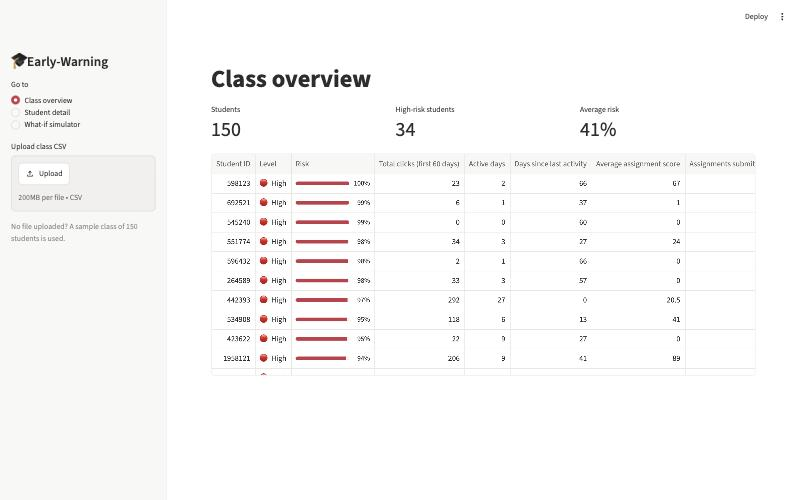

# Student Dropout Early-Warning System

A web dashboard that flags students likely to **withdraw or fail**, using only their **first 60 days** of
activity in an online course. It explains each flag with SHAP and lets a teacher test what-if changes.

**Author:** Kaushik Chakraborty

**Live app:** _link coming after deployment_



## Results

Trained on the Open University Learning Analytics Dataset (OULAD): 26,361 students still enrolled at day 60,
42% of them at risk. Tested on 5,273 students the models never saw.

| Model | Accuracy | Precision | Recall | F1 | ROC-AUC |
|---|---|---|---|---|---|
| Logistic Regression | 0.704 | 0.717 | 0.476 | 0.572 | 0.751 |
| Random Forest | 0.737 | 0.729 | 0.586 | 0.650 | 0.786 |
| **XGBoost** (used in the app) | **0.747** | **0.765** | 0.566 | **0.650** | **0.806** |

The strongest risk signals are a low average assessment score and many days of inactivity
([SHAP plot](figures/06_shap_beeswarm.png)).

## How it works

1. `dropout_project.ipynb` builds 8 features per student from days 0–60, trains three models, explains the
   best one with SHAP, and saves it as `model.pkl`.
2. `app.py` is a Streamlit app with three pages: **Class overview** (students ranked by risk), **Student detail**
   (why a student is flagged) and **What-if simulator** (how changes in behaviour would change the risk).

## Run it locally

```bash
python -m venv venv
source venv/bin/activate        # Windows: venv\Scripts\activate
pip install -r requirements.txt
streamlit run app.py
```

On a Mac, XGBoost also needs OpenMP: `brew install libomp`.

## Use your own class

Upload a CSV in the sidebar with these 8 columns (a `student_id` column is optional):
`total_clicks, active_days, days_inactive, avg_score, num_submitted, num_late, num_of_prev_attempts, studied_credits`.
`sample_class.csv` shows the format.

## Retrain the model

Download OULAD, save it as `data/download/oulad.zip`, and run the notebook top to bottom. It also runs in
Google Colab, where it reads `My Drive/dropout-project/oulad.zip`. If your library versions change, copy the
versions printed by the notebook's last cell into `requirements.txt`.

## Data

Kuzilek, J., Hlosta, M. and Zdrahal, Z. (2017). Open University Learning Analytics dataset.
*Scientific Data* 4, 170171. Licensed CC BY 4.0.
